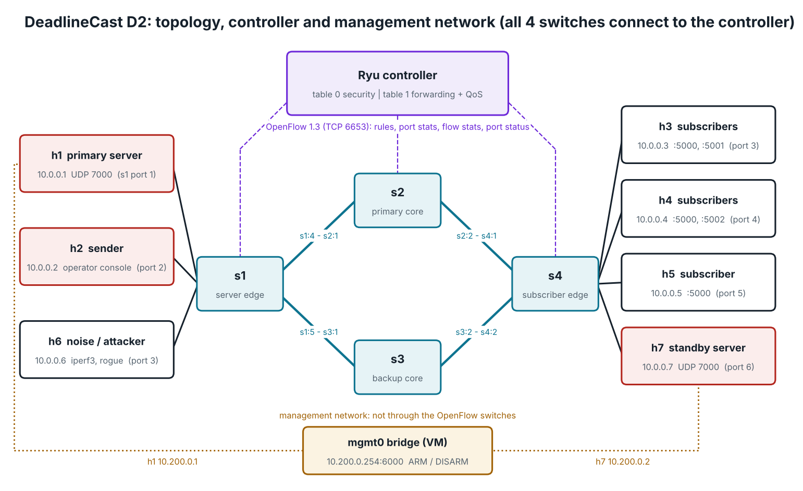
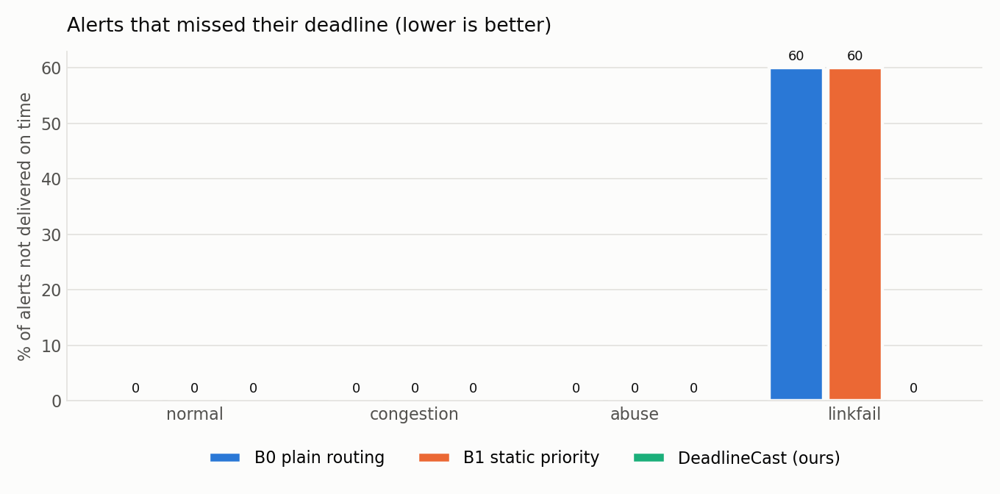
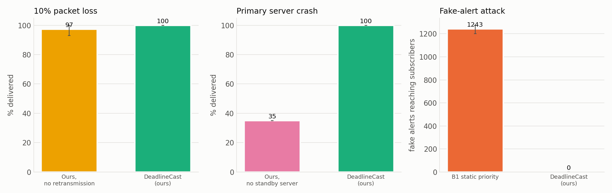

# DeadlineCast: Emergency Notification Network (UDP + SDN)

Project #16, SDN-Socket Programming Jackfruit Mini Project. **Final deliverable (D2).**
D1 documentation: [docs/README_d1.md](docs/README_d1.md).

A UDP emergency notification system on a Mininet network controlled by a Ryu SDN controller.
An operator sends an alert to a broker server, which delivers it to registered subscribers, confirms
delivery with ACKs, and fails over to a standby server if it crashes. The controller gives alerts a
high-priority queue only while an alert is active, routes them over the least-loaded path, reroutes
around failed links, and quarantines hosts that fake urgent traffic or send fake alerts.

---

## 1. Problem and objectives

Emergency alerts are small, urgent, go to many people at once, and are worth nothing if they arrive
late. They are needed most when the network is under stress: congested, lossy, partly broken, or
under attack. A plain network treats an alert like any other packet.

**Objectives**

1. Deliver alerts over UDP from a sender, through a broker server, to many subscribers (Project #16).
2. Confirm delivery (ACKs), retransmit to silent subscribers, and stop once an alert's deadline has passed.
3. Survive a server crash: a standby server takes over without the operator doing anything.
4. Classify emergency traffic and give it a high-priority queue, but only from trusted hosts and only during an alert.
5. Let the network react by itself: least-loaded alert paths, rerouting after link failure, quarantining misbehaving hosts.
6. Measure latency, loss and deadline misses under normal, congested, lossy, failed and attacked conditions,
   and compare against two static baselines.

---

## 2. Architecture



| Host | IP | Switch port | Role |
|---|---|---|---|
| h1 | 10.0.0.1 (+ 10.200.0.1 management) | s1:1 | Primary server (broker), UDP 7000 |
| h2 | 10.0.0.2 | s1:2 | Sender (operator console) |
| h6 | 10.0.0.6 | s1:3 | Noise / attacker (iperf3, rogue alerts) |
| h3 | 10.0.0.3 | s4:3 | Subscribers on ports 5000 and 5001 |
| h4 | 10.0.0.4 | s4:4 | Subscribers on ports 5000 and 5002 |
| h5 | 10.0.0.5 | s4:5 | Subscriber on port 5000 |
| h7 | 10.0.0.7 (+ 10.200.0.2 management) | s4:6 | Standby server, UDP 7000 |

- **Switches:** s1 (server edge) and s4 (subscriber edge) are joined by two core paths, s2 (primary) and
  s3 (backup). Every switch port is capped at 10 Mbps with three queues: q2 alerts (served first),
  q1 ACKs/heartbeats/registrations, q0 everything else.
- **Management network:** h1 and h7 reach the controller (10.200.0.254:6000) over a separate Linux bridge
  `mgmt0`, so ARM/DISARM never compete with the data they control.
- **Single source of truth:** `topology/netconf.py` defines hosts, ports and links. The topology, the
  controller and the experiment runner all read it.

### Communication flow for one alert

1. Subscribers `REGISTER` with **both** servers and get `REG_OK`; servers send `HEARTBEAT`s every 3 s.
2. The sender sends `ALERT` (DSCP 46, HMAC-signed) to the primary; the primary replies `ALERT_ACCEPTED`.
   If the primary does not answer within 1 s, the sender sends the same alert to the standby.
3. The server sends `ARM` to the controller. The controller picks the least-loaded path to the subscribers,
   installs temporary queue-2 rules along it, waits for the switches to confirm (barrier), and replies `ARM_OK`.
4. The server sends the signed alert to every subscriber; each verifies the signature, shows it and `ACK`s.
5. Silent subscribers get a retransmission after 0.5 s, until 3 tries or the alert's deadline (CRITICAL 1000 ms).
6. When no alert is in flight, the server sends `DISARM`; the controller removes the alert rules.

---

## 3. Application (UDP sockets)

Files: `app/common.py` (shared settings), `app/server.py`, `app/sender.py`, `app/subscriber.py`.

| Message | From → To | Purpose |
|---|---|---|
| REGISTER / REG_OK | Subscriber → both servers | Join; re-register automatically if a server restarts |
| UNREGISTER | Subscriber → both servers | Leave (Ctrl+C) |
| ALERT | Sender → server, server → subscribers | Alert with `alert_id`, `priority`, `deadline_ms`, `seq`, `ts`, `try`, `srv`, `sig` |
| ALERT_ACCEPTED / ALERT_REJECTED | Server → sender | Accepted (with seq and subscriber count) or rejected (bad signature) |
| ACK | Subscriber → the server that sent the alert | Delivery confirmation for `seq` + `alert_id` |
| HEARTBEAT | Servers → subscribers, primary → standby | Liveness, every 3 s; 3 missed = server down |
| ARM / DISARM | Server → controller (management network) | Enable / remove alert priority |

- **Concurrency:** the server's main thread receives; each alert fans out in its own thread; separate
  threads handle retransmission, heartbeats and (standby) primary monitoring; a lock protects shared state.
  The subscriber uses `select()` over its alert socket and two heartbeat sockets.
- **Reliability:** per-subscriber ACK tracking, retransmission only to silent subscribers, bounded by
  3 tries and by the alert deadline; duplicates (from retransmission or failover) are ACKed but shown once.
- **Failover:** subscribers register with both servers; the sender fails over after 1 s and then keeps
  using the standby (it re-tries the primary every 10 s).
- **Security:** alerts carry an HMAC-SHA256 signature (`USE_HMAC = True` in `app/common.py`); unsigned or
  tampered alerts are rejected by the server and by subscribers.
- **Logging:** each subscriber writes one CSV row per unique alert:
  `seq, alert_id, srv, priority, alert_type, sent_ts, recv_ts, latency_ms, try, deadline_ms, late`.

---

## 4. SDN controller (Ryu, OpenFlow 1.3)

File: `controller/deadlinecast_ryu.py`. Two flow tables per switch:

| Table | Priority | Match | Action | Purpose |
|---|---|---|---|---|
| 0 | 450 | IPv6 | drop | No background chatter |
| 0 | 400 | in_port of a quarantined host | drop (30 s hard timeout) | **Blocking** |
| 0 | 360 | untrusted host → UDP 5000/5001/5002 | drop | **Filtering**: only servers may send alerts |
| 0 | 355 | untrusted host, DSCP 46 or 34 | set DSCP 0, goto 1 | Anti-spoofing of priority |
| 0 | 300 | in_port + the host's own source IP | goto 1 | Source-IP validation |
| 0 | 290 | in_port, any other source IP | drop | Forged source addresses |
| 0 | 0 | anything else | goto 1 | |
| 1 | 350 | server → subscriber, DSCP 46/34 | queue 2, out on least-loaded path | **Prioritisation** (installed on ARM, removed on DISARM) |
| 1 | 340 | sender → server/standby, DSCP 46/34 | queue 2 | Operator alerts |
| 1 | 330 | UDP to server port 7000, heartbeats | queue 1 | Control traffic protection |
| 1 | 10 | destination IP | out on shortest live path | **Routing** |
| 1 | 0 | anything else | to controller | Proxy ARP (no flooding in the looped topology) |

**Dynamic behaviour**

| Mechanism | Trigger | Reaction |
|---|---|---|
| Prioritisation | ARM / DISARM from a server | Install / remove queue-2 alert rules (with barrier) |
| Monitoring | Port stats every 1 s | Per-link Mbps, logged to `linkstats.csv`, printed as `LOAD` |
| Load-aware routing | ARM, and every second while armed | Alerts take the least-loaded path (cost = hops + 10 × utilisation, 1 Mbps floor, hysteresis) |
| Recovery / rerouting | Port-status event (link down/up) | All routes and alert paths recomputed and reinstalled, time logged |
| Detection + blocking | Flow stats every 1 s on the table-0 counters | Host sending > 50 fake-urgent pkt/s, > 5 fake alerts/s or > 5 forged-IP pkt/s is quarantined for 30 s |

**Baselines** (same code, features switched off, so the comparison is fair):

| Controller | File | Behaviour |
|---|---|---|
| B0 plain | `controller/baseline_plain.py` | Static shortest-path routing, no priority queues, no reaction to anything |
| B1 static priority | `controller/baseline_static.py` | B0 + any packet marked DSCP 46/34 always gets queue 2, from any host |
| DeadlineCast | `controller/deadlinecast_ryu.py` | Everything in the tables above |

The baselines answer ARM/DISARM immediately without acting, so alert timing is identical in all three.

---

## 5. Repository structure

```
app/            common.py, server.py, sender.py, subscriber.py        UDP application
controller/     deadlinecast_ryu.py (D2), baseline_static.py, baseline_plain.py, deadlinecast_d1.py (D1)
topology/       netconf.py (shared definition), topo.py (D2), topo_d1.py (D1), qos_setup.sh
tools/          start_app.mn, auto_sender.py, rogue_alerts.py, arm_test.py, collect_results.py (D1)
experiments/    run_experiments.py, analyze.py, plot.py, report.py
docs/           architecture_d2.png, test_cases_d2.md, demo_script_d2.md, README_d1.md, D1 docs
results/        D1 results (results/*.md), D2 results (results/d2/: RESULTS.md, summary.csv, figs/, raw/)
logs/           runtime logs of interactive runs (not committed)
```

---

## 6. Setup (Ubuntu VM, done once)

```bash
sudo apt update
sudo apt install -y mininet openvswitch-switch iperf3 tcpdump git curl unzip iptables python3-matplotlib
sudo systemctl enable --now openvswitch-switch
sudo modprobe sch_netem || sudo apt install -y linux-modules-extra-$(uname -r)   # packet-loss emulation
```

Ryu runs in its own Python 3.9 environment (it does not work on newer Python):

```bash
curl -LsSf https://astral.sh/uv/install.sh | sh && source $HOME/.local/bin/env
uv python install 3.9 && uv venv --python 3.9 --seed ~/ryu-env
source ~/ryu-env/bin/activate
pip install "setuptools==58.2.0" wheel pbr && pip install --no-build-isolation ryu "eventlet==0.30.2"
deactivate
```

If `sch_netem` cannot be loaded, the experiments fall back to `iptables` random drops automatically
(`loss_method.txt` in each run folder says which was used).

---

## 7. Running

### Interactive (demo)

```bash
# Terminal A
cd ~/emergency-sdn && sudo mn -c
# Terminal B (start after mn -c)
cd ~/emergency-sdn && source ~/ryu-env/bin/activate
ryu-manager --ofp-tcp-listen-port 6653 controller/deadlinecast_ryu.py
# Terminal A
sudo python3 topology/topo.py
mininet> pingall
mininet> source tools/start_app.mn
mininet> h2 python3 app/sender.py 10.0.0.1
# Terminal C (live view of one subscriber)
cd ~/emergency-sdn && tail -F logs/h3a.out
```

The full demo, including congestion, link failure, server crash and attacks, is in
[docs/demo_script_d2.md](docs/demo_script_d2.md). Test cases: [docs/test_cases_d2.md](docs/test_cases_d2.md).

### Automated experiments (results for the report)

```bash
cd ~/emergency-sdn
sudo python3 experiments/run_experiments.py            # all scenarios x controllers x 3 repetitions
python3 experiments/plot.py && python3 experiments/report.py
```

Each run starts a fresh controller and network, so runs are independent. Use `--reps 1` for a quick pass
or `--only linkfail,abuse` for some scenarios.

---

## 8. Scenarios and metrics

| Scenario | What happens | Compared |
|---|---|---|
| normal | No background traffic | B0, B1, ours |
| congestion | h6 floods h3 with 12 Mbps of UDP over 10 Mbps links | B0, B1, ours |
| abuse | Same flood, but marked DSCP 46 (fake urgent) | B0, B1, ours |
| linkfail | Link s1-s2 cut 4 s into the run | B0, B1, ours |
| loss | 10% random loss on the server's link | ours without vs with retransmission |
| failover | Primary server killed 4 s into the run | ours without vs with standby |
| fakealert | h6 sends fake unsigned alerts, half with the server's forged IP | B1, ours |

Each run: 20 CRITICAL alerts, 0.5 s apart, to 5 subscribers. Metrics: delivery %, **deadline-miss %**
(not delivered or later than 1000 ms), latency avg/p95/max, end-to-end latency, first-try %,
retransmissions, alerts via standby, fake alerts reaching subscribers, quarantines, reroute time,
background throughput.

---

## 9. Results

See **[results/d2/RESULTS.md](results/d2/RESULTS.md)** for every table and chart, generated directly from
the measured data by `experiments/report.py`.




---

## 10. Rubric coverage

| Component (marks) | Where |
|---|---|
| Complete application functionality (4) | Sections 2-3: sender, broker, 5 subscribers, two servers, ACK/retransmit, deadlines, failover, HMAC |
| Dynamic SDN functionality (6) | Section 4: ARM/DISARM prioritisation, monitoring, load-aware routing, link-failure rerouting, filtering, detection + quarantine |
| Challenging scenario / robustness (4) | Section 8: congestion, priority abuse, link failure, packet loss, server crash, fake alerts |
| Performance evaluation and comparison (5) | Sections 8-9: 7 scenarios, 2 static baselines, repeated runs, charts and tables |
| Documentation, final demo and viva (6) | This README, docs/demo_script_d2.md, docs/test_cases_d2.md, reproducible runner |

## 11. Team

 Member | Responsibility |
|---|---|
| Shubham Jalori | UDP application: standby server and failover, heartbeats, DISARM, deadlines, HMAC |
| Shubha M | Multi-switch topology, controller: routing, monitoring, rerouting, filtering, quarantine, baselines |
| Suman Kalyani Das | Experiment runner, failure and attack scenarios, analysis, charts, documentation, demo script |

## 12. Limitations

- One shared HMAC key for all hosts; public-key signatures would let subscribers verify servers without a shared secret.
- Topology and host locations are configured (`netconf.py`), not discovered with LLDP.
- Loss emulation and queues run on virtual links; absolute numbers depend on the VM's CPU.
- Failover is driven by the sender's 1 s timeout; heartbeats detect a dead server after 9 s.
