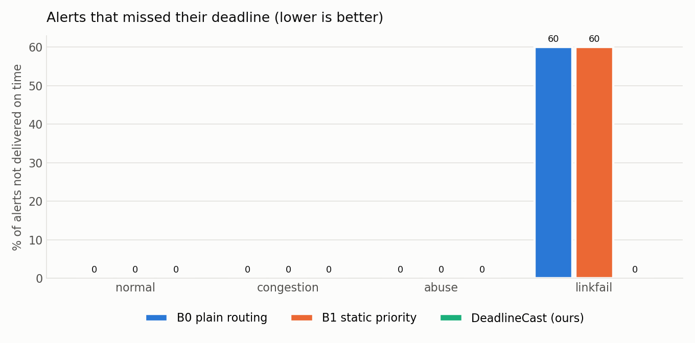
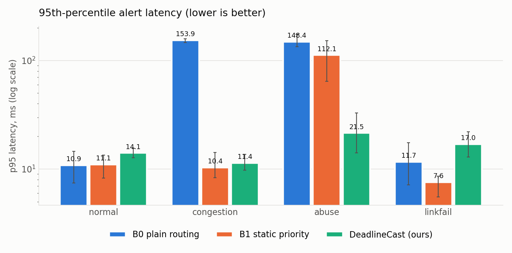
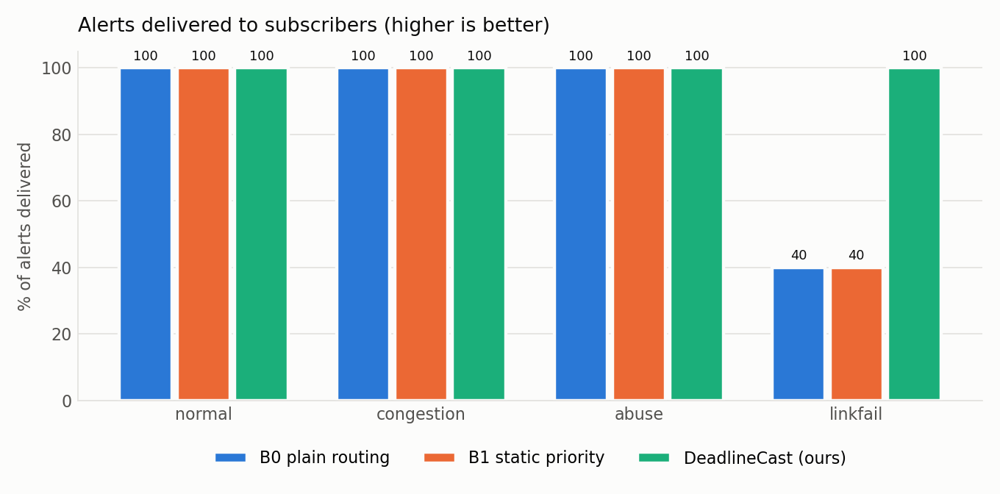
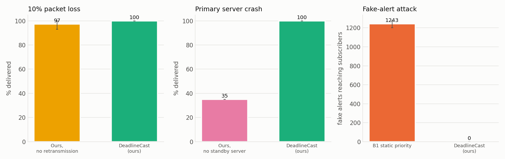
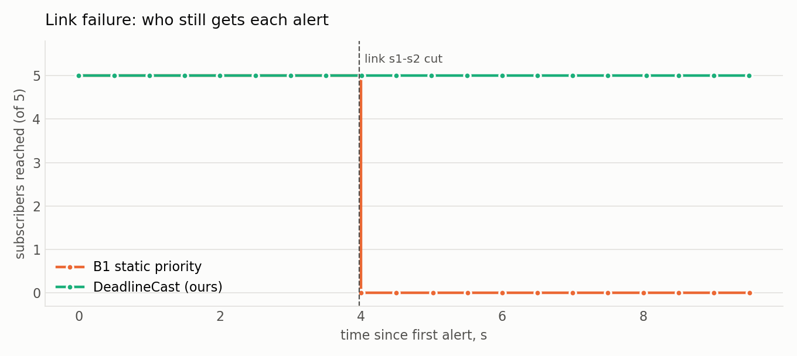
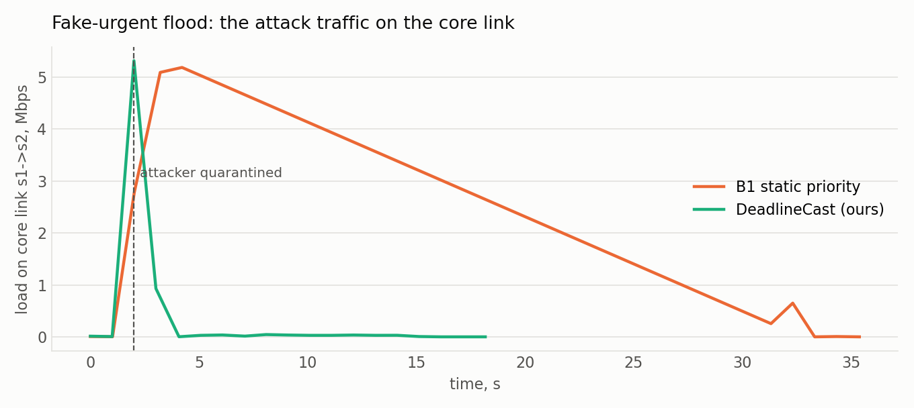

# D2 results

Generated from `results/d2/summary.csv` (57 runs). Each run: 20 CRITICAL alerts, 0.5 s apart, to 5 subscribers; deadline 1000 ms. Values are means over the repetitions.

## Key findings

- **Congestion (12 Mbps flood):** DeadlineCast 0.0% deadline misses, static priority 0.0% deadline misses, plain routing 0.0% deadline misses.
- **Fake-urgent flood (DSCP 46 abuse):** DeadlineCast 0.0% deadline misses, static priority 0.0% deadline misses, plain routing 0.0% deadline misses.
- **Link failure:** DeadlineCast 100.0% delivered, static priority 40.0% delivered, plain routing 40.0% delivered.
- **Reroute time after the link failure:** 83.4 ms (controller detects the port-down event and reinstalls all routes).
- **10% packet loss:** 100.0% delivered with retransmission vs 97.3% without.
- **Primary server crash:** 100.0% delivered with the standby vs 35.0% without; 12.0 alerts per run went through the standby.
- **Fake-alert attack:** 0 fake alerts reached subscribers with DeadlineCast vs 1243 with static priority (where HMAC still rejected them at the application).

## normal: no background traffic

| Configuration | Runs | Delivered % | Deadline miss % | Avg ms | p95 ms | Max ms | End-to-end p95 ms | First try % | Retx | Via standby | Fakes reached | Quarantines | Reroute ms | Flood Mbps |
|---|---|---|---|---|---|---|---|---|---|---|---|---|---|---|
| B0 plain routing | 4 | 100.0 | 0.0 | 4.0 | 10.9 | 17.5 | 23.5 | 100 | 0.0 | 0.0 | 0 | 0.0 | - | 0.0 |
| B1 static priority | 4 | 100.0 | 0.0 | 4.1 | 11.1 | 18.0 | 26.8 | 100 | 0.0 | 0.0 | 0 | 0.0 | - | 0.0 |
| DeadlineCast (ours) | 4 | 100.0 | 0.0 | 8.1 | 14.1 | 27.0 | 62.4 | 100 | 0.0 | 0.0 | 0 | 0.0 | 332.6 | 0.0 |

## congestion: h6 floods h3 with 12 Mbps of normal UDP over 10 Mbps links

| Configuration | Runs | Delivered % | Deadline miss % | Avg ms | p95 ms | Max ms | End-to-end p95 ms | First try % | Retx | Via standby | Fakes reached | Quarantines | Reroute ms | Flood Mbps |
|---|---|---|---|---|---|---|---|---|---|---|---|---|---|---|
| B0 plain routing | 3 | 100.0 | 0.0 | 99.0 | 153.9 | 205.7 | 166.0 | 100 | 0.0 | 0.0 | 0 | 0.0 | - | 0.0 |
| B1 static priority | 3 | 100.0 | 0.0 | 4.1 | 10.4 | 16.3 | 29.5 | 100 | 0.0 | 0.0 | 0 | 0.0 | - | 0.0 |
| DeadlineCast (ours) | 3 | 100.0 | 0.0 | 6.3 | 11.4 | 15.3 | 55.8 | 100 | 0.0 | 0.0 | 0 | 0.0 | 312.5 | 0.0 |

## abuse: h6 floods h3 with 12 Mbps marked DSCP 46 (fake urgent)

| Configuration | Runs | Delivered % | Deadline miss % | Avg ms | p95 ms | Max ms | End-to-end p95 ms | First try % | Retx | Via standby | Fakes reached | Quarantines | Reroute ms | Flood Mbps |
|---|---|---|---|---|---|---|---|---|---|---|---|---|---|---|
| B0 plain routing | 3 | 100.0 | 0.0 | 100.1 | 148.4 | 183.1 | 161.1 | 100 | 0.0 | 0.0 | 0 | 0.0 | - | 0.0 |
| B1 static priority | 3 | 100.0 | 0.0 | 63.8 | 112.1 | 133.0 | 126.7 | 100 | 0.0 | 0.0 | 0 | 0.0 | - | 0.0 |
| DeadlineCast (ours) | 3 | 100.0 | 0.0 | 9.1 | 21.5 | 33.5 | 62.0 | 100 | 0.0 | 0.0 | 0 | 1.0 | 321.4 | 0.0 |

## linkfail: link s1-s2 goes down 4 s into the run

| Configuration | Runs | Delivered % | Deadline miss % | Avg ms | p95 ms | Max ms | End-to-end p95 ms | First try % | Retx | Via standby | Fakes reached | Quarantines | Reroute ms | Flood Mbps |
|---|---|---|---|---|---|---|---|---|---|---|---|---|---|---|
| B0 plain routing | 3 | 40.0 | 60.0 | 4.1 | 11.7 | 13.6 | 24.5 | 100 | 12.0 | 0.0 | 0 | 0.0 | - | 0.0 |
| B1 static priority | 3 | 40.0 | 60.0 | 3.7 | 7.6 | 8.7 | 21.4 | 100 | 12.0 | 0.0 | 0 | 0.0 | - | 0.0 |
| DeadlineCast (ours) | 3 | 100.0 | 0.0 | 16.5 | 17.0 | 192.8 | 82.8 | 98 | 0.7 | 0.0 | 0 | 0.0 | 83.4 | 0.0 |

## loss: 10% random packet loss on the server's link

| Configuration | Runs | Delivered % | Deadline miss % | Avg ms | p95 ms | Max ms | End-to-end p95 ms | First try % | Retx | Via standby | Fakes reached | Quarantines | Reroute ms | Flood Mbps |
|---|---|---|---|---|---|---|---|---|---|---|---|---|---|---|
| Ours, no retransmission | 3 | 97.3 | 2.7 | 5.1 | 11.4 | 16.8 | 56.5 | 100 | 0.0 | 16.7 | 0 | 0.0 | 315.8 | 0.0 |
| DeadlineCast (ours) | 3 | 100.0 | 0.0 | 28.1 | 181.0 | 547.8 | 225.1 | 96 | 3.7 | 15.7 | 0 | 0.0 | 361.4 | 0.0 |

## failover: primary server crashes 4 s into the run

| Configuration | Runs | Delivered % | Deadline miss % | Avg ms | p95 ms | Max ms | End-to-end p95 ms | First try % | Retx | Via standby | Fakes reached | Quarantines | Reroute ms | Flood Mbps |
|---|---|---|---|---|---|---|---|---|---|---|---|---|---|---|
| Ours, no standby | 3 | 35.0 | 65.0 | 81.5 | 521.4 | 522.7 | 551.6 | 86 | 2.0 | 0.0 | 0 | 0.0 | 228.1 | 0.0 |
| DeadlineCast (ours) | 3 | 100.0 | 0.0 | 6.7 | 14.5 | 29.4 | 70.7 | 100 | 0.0 | 12.0 | 0 | 0.0 | 409.7 | 0.0 |

## fakealert: h6 sends fake unsigned alerts to subscribers, half with a forged server IP

| Configuration | Runs | Delivered % | Deadline miss % | Avg ms | p95 ms | Max ms | End-to-end p95 ms | First try % | Retx | Via standby | Fakes reached | Quarantines | Reroute ms | Flood Mbps |
|---|---|---|---|---|---|---|---|---|---|---|---|---|---|---|
| B1 static priority | 3 | 100.0 | 0.0 | 3.9 | 8.2 | 44.8 | 23.7 | 100 | 0.0 | 0.0 | 1243 | 0.0 | - | 0.0 |
| DeadlineCast (ours) | 3 | 100.0 | 0.0 | 7.6 | 12.2 | 14.8 | 62.1 | 100 | 0.0 | 0.0 | 0 | 1.0 | 300.1 | 0.0 |

## Charts

## Column guide

- **Delivered %**: unique alerts received / (alerts sent x 5 subscribers).
- **Deadline miss %**: alerts not delivered, or delivered later than their deadline (1000 ms).
- **Avg / p95 / Max ms**: server-to-subscriber latency of delivered alerts.
- **End-to-end p95 ms**: operator press to subscriber screen (includes failover waits).
- **First try %**: delivered without needing a retransmission.
- **Fakes reached**: fake alerts that reached a subscriber program (rejected by HMAC or shown).
- **Reroute ms**: time from the link-down event to all routes being reinstalled.
- **Flood Mbps**: background traffic that actually got through (the cost side of prioritisation).
